# PantryPress: Architecture High-Level Design

*Draft v0.2, 2026-10-23. For review and editing by the owner. Pre-build: PP0.1 and PP0.2 are done; no code
exists yet. v0.2 re-reviews against ADRs 0001 to 0018 and the decisions record (repo commit `7486a03`).*

PantryPress is one Aspire application: six .NET services, two Angular apps, and its own SQL Server, Redis and
blob storage. Its public tier is cache-first, so readers never reach SQL. This document pulls the
architecture out of the requirements, the customization spec, the repo toolkit and the SCRUB build plan into
one view. Section 13 lists where those sources disagree.

---

## Contents

1. [Purpose, scope and sources](#1-purpose-scope-and-sources)
2. [System context](#2-system-context)
3. [Principles and key decisions (the ADRs)](#3-principles-and-key-decisions-the-adrs)
4. [Logical architecture](#4-logical-architecture)
5. [Multitenancy, routing and site isolation](#5-multitenancy-routing-and-site-isolation)
6. [Publishing pipeline and public rendering](#6-publishing-pipeline-and-public-rendering)
7. [Site design: Studio customization and theme snapshots](#7-site-design-studio-customization-and-theme-snapshots)
8. [Data architecture](#8-data-architecture)
9. [Integrations](#9-integrations)
10. [Security and identity](#10-security-and-identity)
11. [Deployment, environments and operations](#11-deployment-environments-and-operations)
12. [Delivery roadmap (SCRUB phases)](#12-delivery-roadmap-scrub-phases)
13. [Conflicts and gaps found in review](#13-conflicts-and-gaps-found-in-review)
14. [Open decisions and risks](#14-open-decisions-and-risks)

---

## 1. Purpose, scope and sources

**Purpose:** a single architecture reference the owner can review, edit and then commit as
`docs/architecture/pantrypress-design.md`. `docs/architecture/README.md` already links that file, but it does
not exist yet. This document is written to fill that slot.

**Decisions:** the ADRs are `docs/architecture-decisions/0001` to `0018`. ADR `NNNN` records decision
`PP-DNN`, and `pantrypress.md` in that folder is the index and the open DECIDE register (D-02, D-07 and so on).
This document cites ADRs by number and does not restate them. If this document and an ADR disagree, the ADR
wins.

**Sources reviewed:** repo `architect4hire/pantrypress`, branch `dev`, commit `7486a03` (2026-10-23):

| Source | What it governs |
| --- | --- |
| `docs/architecture-decisions/0001`–`0018`, `pantrypress.md` | ADRs, owner decisions, open DECIDE register, reconciliation log |
| `docs/architecture.md`, `docs/architecture/README.md` | Architecture entry points |
| `CLAUDE.md` | Scope, stack, solution layout, invariants (the "constitution") |
| `.claude/rules/*.md` (17 files) | Per-area rules: tenancy, rendering, backend, auth, gateway, publishing API and more |
| `.claude/skills/` (12), `.claude/agents/` (7), `.claude/hooks/` (3) | Procedures, read-only reviewers, guard rails |
| `docs/requirements/pantrypress-requirements.md` v2.1 | Functional source of truth, PP-D01 to PP-D18 |
| `docs/requirements/pantrypress-customization-spec.md` | Studio options, token contract, theme snapshot, plan gating |
| `docs/prompts/pantrypress-scrub-prompts.md` | Build plan: 21 phases (PP0 to PP20), 257 prompts |
| Project files `pantrypress/` | Newer copy of the requirements (section 6 wording differs, see O-08) |

---

## 2. System context

PantryPress is a standalone multitenant SaaS. Every outside party calls in, and PantryPress calls out only
through typed provider gateways. **PantryPress never calls CreatorPantry** (ADR 0015).

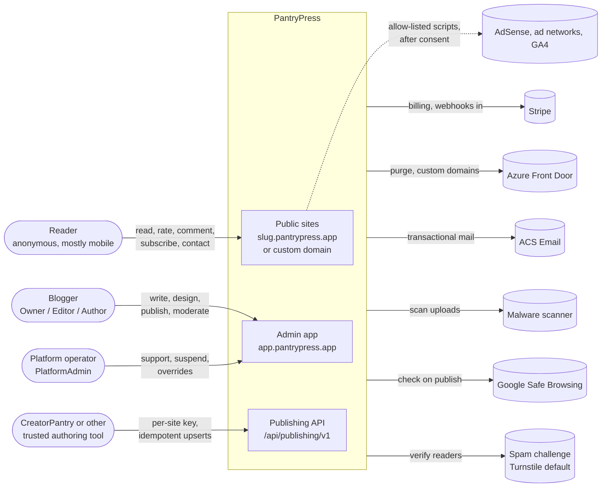

| Party | Enters through | Purpose |
| --- | --- | --- |
| Reader | Front Door to the SSR site and `/api/public/*` | Read posts and recipes; rate, comment, subscribe, contact |
| Blogger | `app.pantrypress.app` via the Gateway BFF | Author, design, publish, moderate, export |
| Platform operator | Admin app operator console (`PlatformAdmin`) | Support, abuse takedown, plan overrides |
| CreatorPantry (optional) | `/api/publishing/v1` with a per-site key | Push drafts and publish; read status and live URL |
| Stripe | Out via gateway; signed webhooks in | Prices, checkout, portal, tax, dunning |

**Out of the system:** AI or model calls (ADR 0012), plugins or custom CSS/HTML (closed set), newsletter
sending (ADR 0014), a consumer recipe index, self-hosting.

---

## 3. Principles and key decisions (the ADRs)

**Principles**

1. **The site is the tenant.** Every site-scoped feature proves isolation with a two-site test.
2. **Cache first.** Public pages keep working when SQL, ApiService or the Worker is down.
3. **Publishing is a snapshot.** Readers only ever see immutable published revisions.
4. **Deterministic everything.** No AI, exact rational recipe arithmetic, byte-identical SSR output.
5. **Closed feature set.** Design freedom comes from typed settings, never code.
6. **Operable by one person.** Automation and cache-first delivery keep incidents rare.

**Decisions (ADRs 0001 to 0018)**

Status is copied from the decisions record (`docs/architecture-decisions/pantrypress.md`, section 2).

| ADR | Decision | Architectural consequence | Status | Open item |
| --- | --- | --- | --- | --- |
| 0001 | Own repo and Aspire AppHost; no shared code with CreatorPantry | Nine .NET projects plus the `src/web` Angular workspace (section 4) | Accepted | — |
| 0002 | Cache-first delivery, Angular SSR on every request | Page data built at publish; purge on change; Publish waits for the purge before showing the live URL | Accepted, with open items | D-02 stale-on-error (PP9.4) |
| 0003 | The site is the tenant | `SiteId` filter, stamping and indexes; public tenant from Host only; `IgnoreQueryFilters()` only in `Modules/Platform/` | Accepted | — |
| 0004 | Publishing is a snapshot | Page data reads published revisions only; unpublish removes page data | Accepted | — |
| 0005 | Structured recipes, deterministic calculations | Exact rationals; variants precomputed at build | Accepted | — |
| 0006 | Four data zones | Platform, site-owned, published public, reader-submitted | Accepted | — |
| 0007 | New `@pantrypress/ui` design system | One library with admin and `/themes` entry points; lint rule keeps admin code out of SSR | Accepted, with open items | D-07 packaging (PP3) |
| 0008 | Public site is an Angular 22 SSR app; admin is a client SPA | Hydration only in `@defer` islands; web storage blocked by hook | Accepted, with open items | D-08 budget fallback (PP7.2) |
| 0009 | Stripe owns billing; entitlements in-house | One entitlements facade fed by webhooks | Accepted, with open items | D-09 prices (PP14) |
| 0010 | 14-day trial, no free-forever tier | Trial lifecycle; smaller abuse surface | **Proposed** | D-10 (PP14) |
| 0011 | Third-party scripts by allow-list | Per-site CSP generated from enabled integrations | Accepted, with open items | D-11 networks (PP15.5) |
| 0012 | No AI anywhere | `invariant-guard.mjs` blocks AI SDKs, imports and model endpoints | Accepted | — |
| 0013 | Wildcard domain on Front Door Standard; `__Host-pp-session` cookie; PSL entry | WAF custom rules plus origin lockdown instead of Premium | Accepted, with open items | D-13 Premium trigger; D-13b custom domains beyond one profile (PP17.1) |
| 0014 | Newsletter signup and CSV export only | Transactional email only | Accepted | — |
| 0015 | Publishing API with per-site keys | Idempotent, versioned, same facades as the editor; keys salted SHA-256 | Accepted | — |
| 0016 | Shared Azure, separate data | Shared Front Door profile, Container Apps environment, monitoring workspace | Accepted | — (D-16 closed 2026-10-24: Terraform `platform` stack in this repo) |
| 0017 | Studio customization by typed settings | Settings become an immutable theme snapshot; 20 kept | Accepted, with open items | D-17, THM-001, THM-002, THM-010 |
| 0018 | Section-based pages, no page builder | One section library for homepage and site pages | Accepted, with open items | POST-011 FAQPage (PP8) |

---

## 4. Logical architecture

Two front doors, one domain. Readers enter through Front Door to the Node SSR server and the anonymous site
API. Bloggers enter through the BFF to the authenticated API. Everything that is slow or must survive a crash
runs in the Worker through the transactional outbox.

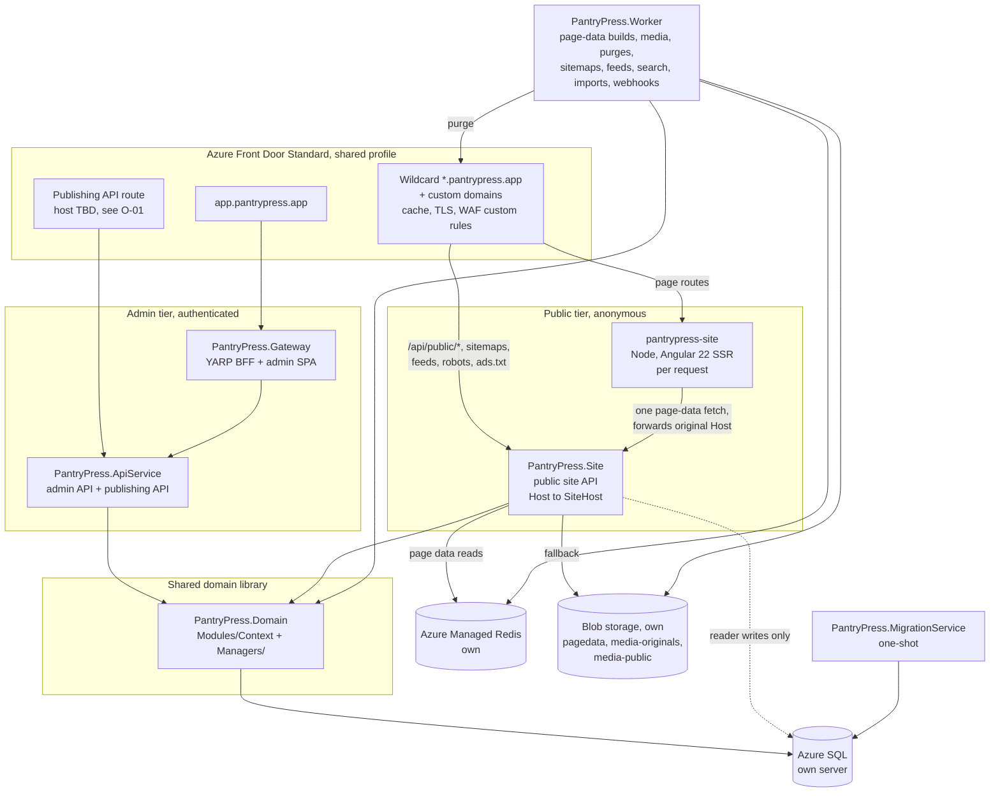

### 4.1 Deployable units (ADR 0001)

| Unit | Kind | Responsibility | Must never |
| --- | --- | --- | --- |
| `PantryPress.AppHost` | Aspire app model | Declares every resource and dependency | Hold app logic |
| `PantryPress.ServiceDefaults` | Library | OpenTelemetry, `/health` and `/alive`, service discovery, resilience | Call SQL from liveness |
| `PantryPress.Gateway` | YARP BFF | Session cookie, antiforgery, header hygiene, admin SPA hosting | Do business logic or DB access |
| `PantryPress.ApiService` | ASP.NET Core API | Admin API `/api/v1/…` and publishing API `/api/publishing/v1/…` | Serve anonymous traffic |
| `PantryPress.Site` | ASP.NET Core API | Page-data reads, reader writes, sitemaps, feeds | Run SQL on page-data reads |
| `PantryPress.Domain` | Library | Module-first domain (`Modules/<Context>/`) plus `Managers/` kernel | Reference a host project |
| `PantryPress.Worker` | Background host | Outbox consumers and jobs | Skip setting `ISiteContext` |
| `PantryPress.MigrationService` | One-shot worker | Applies EF Core migrations before dependents start | Run at app startup |
| `pantrypress-admin` | Angular SPA | Blogger dashboard, editor, Studio customizer | Hold tokens |
| `pantrypress-site` | Angular SSR on Node | Public blog rendering | Access SQL, Redis or blob, or choose a tenant |
| `pantrypress-ui` | Angular library | `@pantrypress/ui` (admin) and `@pantrypress/ui/themes` (public) | Cross-import admin and theme parts |

### 4.2 The request seam (ARCH-002)

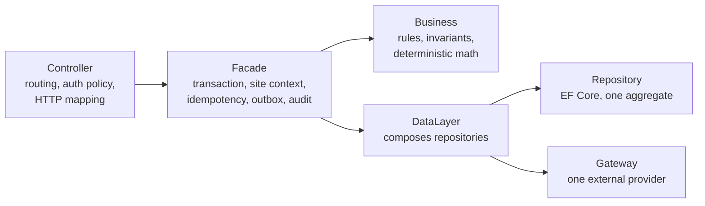

Facades return `Result<T>`, validate with FluentValidation, and own the transaction. Gateways never leak
provider DTOs. Replaying a retried `Idempotency-Key` happens before the controller, in host middleware over the
`Managers` idempotency store (PP1.9); the facade's share of idempotency is making its own work safe to repeat. Modules talk to each other only through public contracts, enforced by boundary tests.

### 4.3 Domain modules

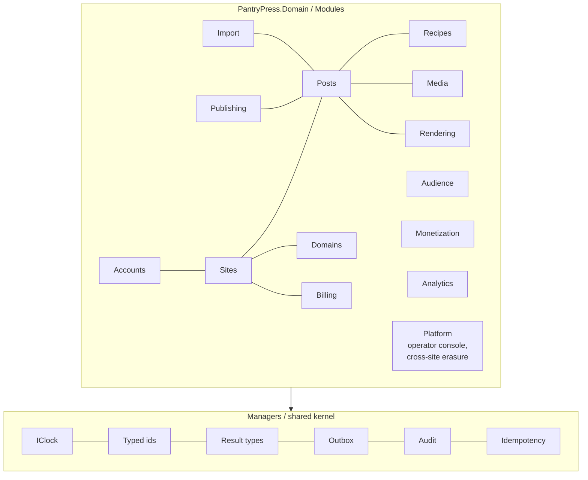

| Module | Owns | Phase |
| --- | --- | --- |
| Accounts | Identity users, 2FA, PlatformAdmin | PP1 |
| Sites | Site, slug, `SiteHost`, membership, settings, theme settings and snapshots, sections | PP2, PP8, PP10, PP11 |
| Recipes | Recipe, revisions, parser, scaling, conversion, JSON-LD | PP4 |
| Posts | Block documents, revisions, taxonomy, publish, schedule, redirects | PP5 |
| Media | Assets, scanning, derivatives, usage, quota | PP6 |
| Rendering | Page-data identity, builders, pointer, sanitizer | PP7, PP8 |
| Audience | Ratings, comments, subscribers, contact | PP12, PP13 |
| Billing | Plans, subscriptions, entitlements facade, webhooks | PP14 |
| Monetization | AdSense, networks, `ads.txt`, affiliates, consent | PP15 |
| Analytics | Beacon, raw buffer, daily aggregates | PP16 |
| Domains | Custom domains, verification, certificates | PP17 |
| Platform | Operator console, the only `IgnoreQueryFilters()` code, cross-site erasure (ADR 0003) | PP19 |
| Publishing | Publishing keys, Publish Format, mapper | PP18 |
| Import | WXR and recipe-plugin import jobs | PP20 |

---

## 5. Multitenancy, routing and site isolation

**The site is the tenant (ADR 0003).** An Identity account can own or join several sites up to its plan limit.
Each site has Owner, Editor and Author members. `PlatformAdmin` is the only platform-wide role.

### 5.1 How a request finds its site

| Surface | Tenant comes from | Rule |
| --- | --- | --- |
| Admin API | Route `{siteSlug}` plus the caller's membership | No membership means no site context and a 404 |
| Public site and SSR | Original `Host`, via `SiteHost` | Trusted only when it arrives through Front Door (`X-Azure-FDID`) |
| Publishing API | The publishing key | The key determines the site; scopes limit actions |
| Worker jobs | `SiteId` in the job payload | Job sets `ISiteContext` before touching data |

A site ID is **never** read from a body, query string, cookie or client header.

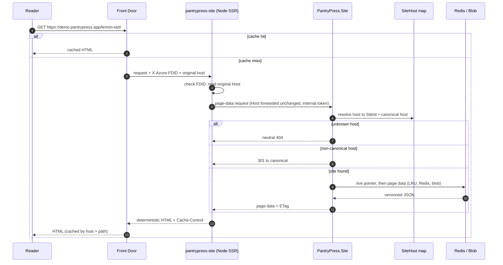

### 5.2 Isolation mechanics (ARCH-015, `tenancy.md`)

- Every site-owned entity implements `ISiteOwned` with a non-nullable `SiteId`.
- A global EF Core query filter applies to all `ISiteOwned` entities, reading `ISiteContext`.
- A `SaveChanges` interceptor stamps `SiteId`; a mismatch with the context fails the save.
- Indexes on site-owned tables lead with `SiteId`.
- Cache keys, blob prefixes, purge tags, search indexes and rate-limit partitions all include the site ID
  through `SiteCacheKey` helpers.
- `IgnoreQueryFilters()` is allowed only in `Modules/Platform/` operator code. A hook blocks it elsewhere.
- **Two-site test** for every change to site-owned, public or reader data, including host-header tricks:
  the other site's host, `Host` versus `X-Forwarded-Host`, uppercase, trailing dot, and the other site's
  custom domain.

### 5.3 Hosts and domains (ADR 0013, DOM)

| Host | Serves |
| --- | --- |
| `{slug}.pantrypress.app` | A blog; wildcard DNS and certificate on Front Door |
| Custom domain (opt-in, paid) | A blog; Front Door managed certificate; becomes canonical, and the subdomain 301s to it |
| `app.pantrypress.app` | Admin SPA and BFF |
| `{slug}.localhost`, `app.localhost` | Local development under Aspire (SITE-009) |

Apply to add `pantrypress.app` to the Public Suffix List, because tenant sites run third-party ad scripts on
sibling subdomains.

---

## 6. Publishing pipeline and public rendering

**Publish creates an immutable published revision. The Worker builds versioned page data from it, writes it
under a new blob prefix, switches one pointer, warms Redis and purges the edge.** Rollback is a pointer
switch. Target: under 60 seconds at p95 from publish to live (POST-009).

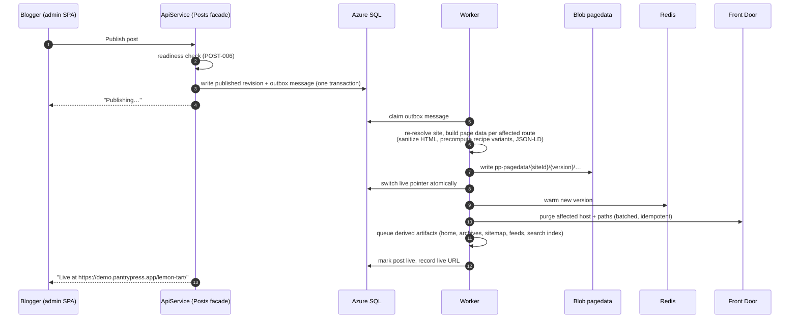

### 6.1 Page data (ADR 0002, ARCH-004 to ARCH-006, ARCH-014)

- Versioned JSON view model per route type: post, print, home, category, tag, archive, page, search, error.
- Built only from published revisions and site settings, never drafts.
- Contracts are .NET ServiceModels with **generated** TypeScript types for the SSR app (PP7.2b).
- Presentation-ready and sanitized: no member, account or draft data, and no provider IDs.
- Keep the last N versions (DECIDE N=5).
- Derived artifacts (home, archives, taxonomy pages, sitemaps, feeds, search index) are rebuilt by jobs.
  Data-backed sections (SITE-011) are part of page data, never queried per request.

### 6.2 SSR rules (ADR 0008, `rendering.md`)

- One page-data fetch per request through the route resolver. No other data access.
- Deterministic output: same page data and build give byte-identical HTML, proved by golden files.
- Complete without JavaScript. Interactivity uses `@defer (hydrate on …)` islands only: scaling and units,
  cook mode, ratings, comments, signup, search, and the minimal-header menu.
- Budget: under 100 KB compressed first-party CSS and JS per page, Angular runtime included, ads excluded.
  CI fails on a breach. PP7.2 measures this first; if Angular cannot fit, hydration is turned off and islands
  become small vanilla scripts.

### 6.3 Caching and degraded mode

| Content | Edge TTL | Purge trigger |
| --- | --- | --- |
| SSR HTML | Long shared TTL, short browser TTL | Publish, unpublish, settings, theme apply, moderation |
| Static assets (hashed) | Immutable | Never (new hash per build) |
| Sitemaps, feeds | Short | Rebuild job |
| Island endpoints (ratings, comments) | Not cached unless marked | Not applicable |

Cache keys always include the host.

| Outage | Effect on readers |
| --- | --- |
| SQL, ApiService or Worker | None: SSR renders from Redis and blob page data |
| `pantrypress-site` or `PantryPress.Site` | Cached pages keep serving from the edge; misses fail (stale-on-error is DECIDE at PP9.4) |
| Redis | Site API falls back to blob plus the in-process LRU |
| Islands | Show a polite degraded state |

---

## 7. Site design: Studio customization and theme snapshots

**Every design choice is a typed setting. On apply, the server compiles settings into an immutable theme
snapshot that SSR writes onto the site root.** Components read only tokens and `data-*` attributes, and public
pages run no customization JavaScript (ADR 0017, THM-007).

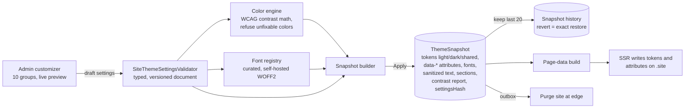

- **Presets are values, not code.** Six launch looks (Market, Hearth, Larder, Farmhouse, Sunny, Supper Club;
  names DECIDE) over one component tree. Market ships in PP7; the rest in PP11.
- **Color engine:** links reach 4.5:1 and dark-mode fills 3:1; a color that cannot pass is refused with a
  suggested nearest shade. A contrast report is stored and shown.
- **Fonts:** 7 heading and 5 body families plus an accent script face, at most 4 font files per page, no
  remote fonts.
- **Layout options:** 5 header styles, announcement bar, 4 hero styles, sidebar right/left/none, text width
  600 to 860 px, 3 recipe card styles, 3 step styles, section order and toggles.
- **Pages (ADR 0018):** one section library for the homepage and site pages; page-only blocks (intro, FAQ,
  social links, contact form); templates for About, Start here and Contact. No page builder.
- **Plan gating** through the entitlements facade. A downgrade keeps saved settings and renders gated options
  at their defaults.
- **Accessibility:** WCAG 2.2 AA in every reachable combination, proved by the CUS-T01 to CUS-T15 test matrix
  in CI.

---

## 8. Data architecture

### 8.1 Data zones (ADR 0006)

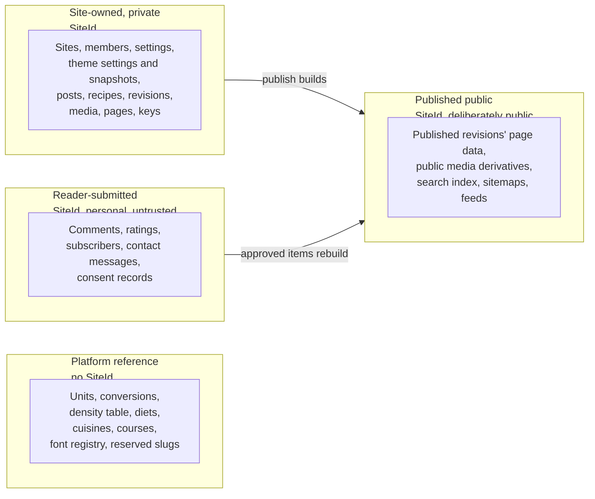

### 8.2 Core entities (simplified)

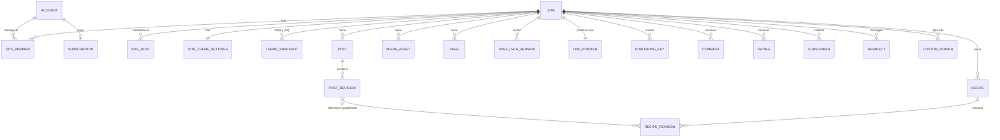

### 8.3 Stores

| Store | Holds | Notes |
| --- | --- | --- |
| Azure SQL (own logical server) | All transactional data, outbox, audit, idempotency records | One `PantryPressDbContext`; migrations only via MigrationService; PITR 35 days; RPO 15 min, RTO 4 h |
| Azure Managed Redis (own) | Warm page data, `SiteHost` map, rate-limit counters | Always keyed with site ID; not the source of truth |
| Blob `pagedata` (private) | Versioned page data `pp-pagedata/{siteId}/{version}/` | Reproducible from published revisions |
| Blob `media-originals` (private) | Immutable uploads after scanning | EXIF location stripped from derivatives |
| Blob `media-public` | Derivatives `media-public/{siteId}/{assetHash}/{variant}` | Served only through Front Door |
| Key Vault (own) | Secrets, certificates | Managed identities only |

Reader personal data is encrypted at rest and minimized. Analytics raw events are discarded within 48 hours.

---

## 9. Integrations

All providers sit behind typed gateways with resilience, fakes for local runs, and no live calls in default
CI. `aspire run` needs no external accounts through PP8.

| Provider | Gateway use | Inbound | Phase |
| --- | --- | --- | --- |
| Stripe | Checkout, portal, resync | Signed webhooks, stored, de-duplicated, processed via outbox | PP14 |
| Azure Front Door | Purge by host and path; custom domain lifecycle | None | PP9, PP17 |
| ACS Email | Transactional mail | Bounce handling | PP13 |
| Malware scanner | Scan uploads, imports, API media | None | PP6 |
| Google Safe Browsing | Check links on publish | None | PP19 |
| Spam challenge (Turnstile default) | Verify reader tokens | None | PP12 |
| AdSense, allow-listed network, GA4 | Browser scripts only, added to CSP when enabled | None | PP15, PP16 |

### 9.1 Publishing API (ADR 0015, PP18)

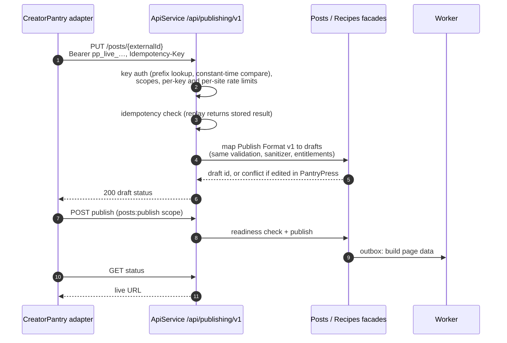

Media arrives by upload or HTTPS fetch through the SSRF-safe fetcher (no private or link-local addresses after
DNS resolution) and the malware scan. CreatorPantry's side (profile, mapper, adapter) lives in its own repo
(requirements section 7.3).

### 9.2 WordPress import (PP20)

Resumable Worker jobs import WXR posts, pages, media, comments, and WP Recipe Maker and Tasty Recipes data,
preserving wording, generating 301s, and never publishing without confirmation.

---

## 10. Security and identity

| Area | Control |
| --- | --- |
| Identity | ASP.NET Core Identity; verified email before publishing (ACCT-001, aligned at PP0.2); optional TOTP (required for PlatformAdmin) |
| Browser boundary | YARP BFF; cookie `__Host-pp-session`, host-only, Secure, HttpOnly, SameSite Lax or stricter; no tokens in the browser; antiforgery on writes; same-origin CORS |
| Authorization | Named policies (`SiteOwner`, `SiteEditor`, `SiteAuthor`, `PlatformAdmin`); facades re-check resource ownership |
| Edge | Front Door Standard WAF custom rules (IP rate limits, geo and IP blocks, bad paths); origins accept only the `AzureFrontDoor.Backend` service tag plus `X-Azure-FDID` |
| Origin rate limits | Per IP, per site and global on public dynamic endpoints; per key and per site on the publishing API |
| Headers | HSTS, `X-Content-Type-Options`, `Referrer-Policy`, `Permissions-Policy`, per-site CSP generated from enabled integrations |
| Content | Allow-list sanitizer at page-data build; no inline handlers or `javascript:` URLs; affiliate links get `rel="sponsored nofollow"` |
| Files | Type sniffing, size limits, malware scanning before anything becomes public |
| Keys and secrets | Publishing keys shown once, stored as salted SHA-256 and compared in constant time (ADR 0015), never logged; secrets in Key Vault or Aspire parameters; secret-scan hook |
| Abuse | Trial instead of free tier, disposable-email blocking, spam challenge, new-site velocity limits, Safe Browsing on publish, takedown workflow |
| Privacy | GDPR, UK GDPR, CCPA; consent records; DSR export and erasure; cookie-free analytics; TCF v2.2 CMP when ads are on |

---

## 11. Deployment, environments and operations

**PantryPress owns its data plane and shares only three cheap, safe Azure resources with CreatorPantry
(ADR 0016).**

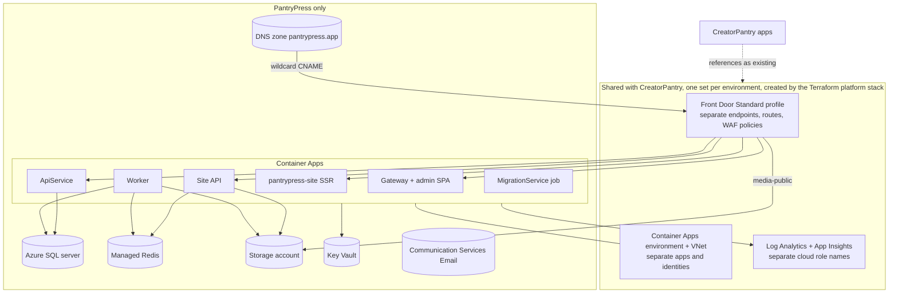

| Concern | Choice |
| --- | --- |
| IaC | Terraform, run from a workstation without a pipeline (OPS-001 closed 2026-10-24): `bootstrap`, a shared `platform` stack, and a `pantrypress` stack under `docs/infrastructure/terraform/`. Plan, SKUs, and costs in `docs/infrastructure/README.md` |
| Environments | local (Aspire), `dev` in Azure (the staging role), production |
| CI | Back end, front end, golden files, accessibility, performance budget, Rich Results, publishing API contract tests on every PR |
| CD | One approved, health-gated workflow with rollback; migrations run explicitly before deploy |
| Observability | OpenTelemetry to the shared workspace; alerts on edge 5xx, origin latency, build backlog age, webhook failures, bounces, certificates, API errors, spend |
| Operations | Operator console, status page, runbooks, quarterly restore drill, Azure budgets at 50, 80 and 100% |

**Targets:** public availability 99.9% at the edge; admin 99.5%; cached TTFB under 200 ms p75; SSR miss under
500 ms p95; edge hit ratio 95% or more; first-year capacity 2,000 sites and 5 million page views a month.

---

## 12. Delivery roadmap (SCRUB phases)

257 prompts in 21 phases, one seam per prompt, plan-first. Phases are ordered by value and risk; Azure is not
needed until PP9.

```mermaid
flowchart LR
    subgraph Foundation[Local foundation, no Azure]
        PP0[PP0 Repo + runtime<br/>8 prompts] --> PP1[PP1 Identity + BFF] --> PP2[PP2 Sites + tenancy<br/>two-site harness] --> PP3[PP3 Design system<br/>+ admin shell]
    end
    subgraph Authoring[Authoring core]
        PP4[PP4 Recipes + math] --> PP5[PP5 Posts, editor,<br/>publish] --> PP6[PP6 Media]
    end
    subgraph Public[Public tier]
        PP7[PP7 Page data + SSR<br/>Market preset] --> PP8[PP8 Site structure + SEO] --> PP9[PP9 Edge delivery<br/>first Azure]
    end
    subgraph Product[Product completeness]
        PP10[PP10 Launch my blog] --> PP11[PP11 Studio design<br/>19 prompts] --> PP12[PP12 Ratings + comments] --> PP13[PP13 Signup + contact]
    end
    subgraph Revenue[Revenue and reach]
        PP14[PP14 Stripe + entitlements] --> PP15[PP15 Ads + affiliates] --> PP16[PP16 Analytics] --> PP17[PP17 Custom domains] --> PP18[PP18 Publishing API]
    end
    subgraph Launch[Launch]
        PP19{{PP19 Ops + launch gate}} --> PP20[PP20 WordPress import]
    end
    PP3 --> PP4
    PP6 --> PP7
    PP9 --> PP10
    PP13 --> PP14
    PP18 --> PP19
```

| Checkpoint | Demonstrable result |
| --- | --- |
| PP0.8 | `aspire run` shows every resource healthy |
| PP2.14 | Two sites cannot see each other; `demo.localhost` resolves |
| PP5.18 | A blogger writes, previews, schedules and publishes a recipe post |
| PP7.14 | The post renders through SSR with SQL stopped |
| PP9.10 | Staging site live over HTTPS via Front Door, updates within 60 s |
| PP11.19 | Presets plus customizer pass accessibility and budget gates |
| PP14.13 | Trial converts through Stripe; downgrade never loses content |
| PP18.12 | A key-authenticated client publishes idempotently |
| PP19.16 | Production launch gate passes |

---

## 13. Conflicts and gaps found in review

v0.1 of this review ran against commit `ebcbb42`, before the ADRs existed. PP0.1 and PP0.2 have since fixed
most of what it found. This section splits the findings into three groups: fixed, open and already recorded,
and open and not yet recorded anywhere.

### 13.1 Fixed by PP0.1 and PP0.2

| Earlier finding | How it was fixed |
| --- | --- |
| No ADR files or `docs/architecture.md` | ADRs 0001 to 0018, `pantrypress.md` and `docs/architecture.md` now exist |
| Angular workspace at root `web/` versus `src/web/` | ADR 0001, CLAUDE.md, README, `format-guard.mjs` and `.claude/README.md` use `src/web` (one leftover in O-12) |
| README prompt numbers (PP0.7, PP0.11, PP0.12) | README and `.claude/README.md` now cite PP0.3, PP0.7 and PP0.8 |
| Admin route `/api/sites/…` versus `/api/v1/sites/…` | `tenancy.md` now uses `/api/v1/sites/{siteSlug}/…` |
| `Modules/Platform/` missing from the module list | Added to `backend.md` |
| Starter design gating differed between requirements and spec | Spec section 15 now matches requirements 2.3 |
| Plus header exclusions ("stacked/banner") | Correction to v0.1: `stacked` is the enum value of the **Masthead** header, so the spec was right. Both documents now say "Banner and Masthead (`stacked`)" |

### 13.2 Open, and already in the decisions record (section 5, "Found at PP0.2")

Fix each one before its prompt writes code.

| Ref | Item | Recommendation |
| --- | --- | --- |
| R-01 | PP18.1 asks for "a slow hash" of publishing keys; ADR 0015 and `auth.md` say salted SHA-256 | Edit PP18.1 to match ADR 0015. Keys are high-entropy random secrets, so a slow hash only adds CPU per request. |
| R-02 | PP2.5 allows `IgnoreQueryFilters()` in "operator and erasure paths"; ADR 0003 allows it only in `Modules/Platform/` | Edit PP2.5: cross-site erasure lives in `Modules/Platform/` |
| R-03 | PP0.3 does not name the solution file; CLAUDE.md and `format-guard.mjs` expect `PantryPress.sln`, while .NET 10 may default to `.slnx` | Decide at PP0.3, then update CLAUDE.md, the hook and `settings.json` together |
| R-04 | Installing an AI SDK with a shell command (`npm install`, `dotnet add package`) bypasses the write hooks | Accept, or add a `Bash` PreToolUse matcher to `invariant-guard.mjs` |

### 13.3 Open, and not yet recorded anywhere

Severity: **High** blocks or misleads an early prompt; **Medium** causes rework or a security gap; **Low** is
wording drift.

| # | Sev | Conflict or gap | Where | Suggested resolution |
| --- | --- | --- | --- | --- |
| O-01 | Medium | **The publishing API has no edge host or route.** `gateway.md` says it "is exposed on its own Front Door route". ADR 0013 and PP9.2 name only the blog wildcard and `app.pantrypress.app`. No host such as `api.pantrypress.app` appears anywhere. | gateway.md vs ADR 0013, PP9.2 | Add the host to ADR 0013 (or ADR 0019) and a route and WAF policy to PP9.2 |
| O-02 | Medium | **Stripe webhook ingress is unplaced.** PP14.5 adds the endpoint without naming the service that hosts it or its route. Requirements 3.2 and the PP-D01 tree put webhooks in the Worker, which has no HTTP ingress. | PP14.5, requirements 3.2 | Host the receiver on ApiService behind the O-01 route; the Worker processes events from the outbox |
| O-03 | Medium | **Admin SPA hosting.** Requirements 5.1 lists a separate "admin web host" Container App; `gateway.md` says the Gateway serves the SPA's static files. | requirements 5.1 vs gateway.md | Gateway hosting: one less app, same-origin by default |
| O-04 | Medium | **Public media has no Front Door route.** `media-public` is "via Front Door only", but PP9.2 defines no origin for blob media. | requirements 5.1 vs PP9.2 | Add a media origin group and route to PP9.2 |
| O-05 | Medium | **Inline styles versus a strict CSP.** Spec 3.3 has SSR write a `<style>` block and inline custom properties. A strict per-site CSP (PSEC-002) must allow them, and byte-identical output (ARCH-005, ADR 0008) rules out per-request nonces. | spec 3.3 vs PSEC-002, ADR 0008 | Put CSP `style-src` hashes in the snapshot, or serve snapshot CSS as a hashed, cacheable file |
| O-06 | High | **No prompt creates the base CI pipeline.** ADR 0001 gives PantryPress its own CI, ADR 0008 says "CI runs the RND-007 budget check on every build", and PP7.2b and PP11.18 add CI checks. The first CI prompt is PP19.3 "CI additions". | SCRUB vs ADR 0001, ADR 0008, OPS-002 | Add PP0.9: GitHub Actions running build, test, format and lint on every PR |
| O-07 | Low | **Referenced skills are missing.** Prompts used `aspire-deployment` (5 times) and use `aspire-monitoring` (twice); neither is in `.claude/skills/`. **Partly resolved 2026-10-24:** the `aspire-deployment` references now point at the `docs/infrastructure` plan and runbook. | SCRUB vs .claude/skills | Add `aspire-monitoring`, or name the plugin that provides it |
| O-08 | Low | **Requirements section 6 is stale.** The repo copy still says "PP0 creates the toolkit". The project-files copy, the toolkit and PP0.2 say the toolkit ships with the repo starter. | requirements section 6 | Take the project-files wording |
| O-09 | Low | **Editor role and design.** SITE-010 gives Editors "all content and moderation"; `auth.md` adds "design". Applying a theme purges the whole site. | requirements vs auth.md | Decide whether Editors can apply Studio changes |
| O-10 | Low | **Derivative timing.** MED-002 and `media.md` say "generated on demand by the Worker"; PP6.5 pre-generates them into `media-public`. "On demand" could be read as request-time generation, which would need its own origin. | MED-002 vs PP6.5 | Reword as "on upload, asynchronously, by the Worker" |
| O-11 | Low | **Starter versus trial.** ADR 0010 proposes a trial with paid-plan features and no free tier, but requirements 2.3 still lists Starter as a tier without saying it is paid. | requirements 2.3 vs ADR 0010 | State that Starter is the lowest paid tier, or rename it |
| O-12 | Low | **One workspace leftover.** `frontend.md` still opens with "Workspace `web/`". | frontend.md | Change it to `src/web/` |
| O-13 | Low | **Design document missing.** `docs/architecture/README.md` links `pantrypress-design.md`, which does not exist. | docs/architecture | Commit this document there once reviewed |
| O-14 | Low | **The project-files repo starter is stale.** `pantrypress/repo-starter/` and its zip predate PP0.1 and PP0.2. | project files | Treat the repo as the source of truth, and delete or refresh the starter |

---

## 14. Open decisions and risks

### 14.1 Open decisions that shape the architecture

The full register is `docs/architecture-decisions/pantrypress.md` section 3. These are the ones that change
the shape of the system.

| Ref | Decision | Default assumed | Closes at |
| --- | --- | --- | --- |
| D-08 | Angular fits the 100 KB budget, or hydration off with vanilla islands | Incremental hydration | PP7.2 |
| D-02 | Front Door stale-on-error | Long TTL plus purge | PP9.4 |
| D-07 | One UI library or two | One library, two entry points | PP3 |
| POST-001 | Editor library | TipTap through an Angular wrapper | PP5.1 |
| D-13b | Custom domains beyond one Front Door Standard profile (100 per profile) | A second profile, or Premium, before 80 on a profile | PP17.1 |
| D-10 | Trial or free Starter (ADR 0010 is still Proposed) | 14-day trial | PP14 |
| D-17 | Plus versus Pro Studio split | Plus gets all but textures and Banner and Masthead | PP11 |
| PP7.12 | Page-data versions kept | 5 | PP7.12 |
| PP18.6 | API update after an editor change | None; the prompt must ask | PP18.6 |
| SITE-004, PP7.3, PP8.10 | Slug renames per year, video hosts, search index size | None; each prompt must ask | Named prompt |

**D-16 closed early (2026-10-24):** as this note used to suggest, D-16 closed ahead of PP9.1, together with
OPS-001. The shared resources are the Terraform `platform` stack in this repository, one set per environment.

### 14.2 Risks

| Risk | Impact | Mitigation |
| --- | --- | --- |
| Angular runtime plus hydration exceeds 100 KB | Breaks RND-007 and Core Web Vitals | PP7.2 spike first; vanilla island fallback (D-08) |
| Full-site purge after a theme release | SSR load spike across all sites | Throttled batch purges (ARCH-012); PNFR-005 load drill |
| No stale-on-error on Front Door Standard | An SSR outage shows errors on cache misses | Long TTLs, warm caches, health-gated deploys (D-02) |
| Front Door Standard caps a profile at 100 custom domains and 10 endpoints | DOM-001 fills one profile long before 2,000 sites | A second profile or Premium before 80 domains, with a platform-wide count in PP17.1 (D-13b) |
| Inbound traffic to an external Container Apps environment cannot be filtered by NSG | An origin reachable without Front Door would bypass the WAF and cache | Per-app ingress allow-list from the `AzureFrontDoor.Backend` service tag, refreshed by each Terraform plan, plus the `X-Azure-FDID` check (PP9.3) |
| Tenant isolation bug | Worst-case incident | Filters, stamping, hook, two-site tests, isolation auditor (ADR 0003) |
| Trial subdomains abused | Reputation and blocklisting of `pantrypress.app` | PSL entry, trial, velocity limits, Safe Browsing, takedown |
| Studio combination explosion | Accessibility and layout regressions | Typed options, contrast engine, CUS-T matrix in CI |
| CI arrives late (O-06) | Budget, golden-file and isolation regressions merge unnoticed for 18 phases | Base CI in PP0 |
| One developer | Bus factor and ops load | Cache-first design, automation, runbooks, KPI-007 under 4 h a week |
