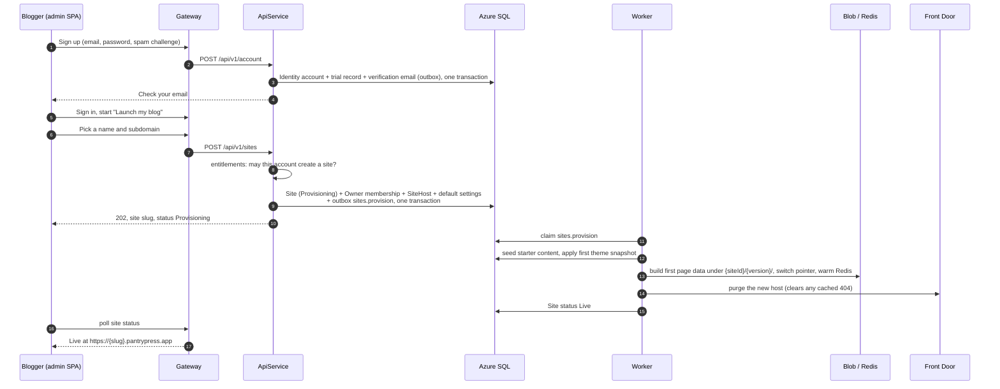
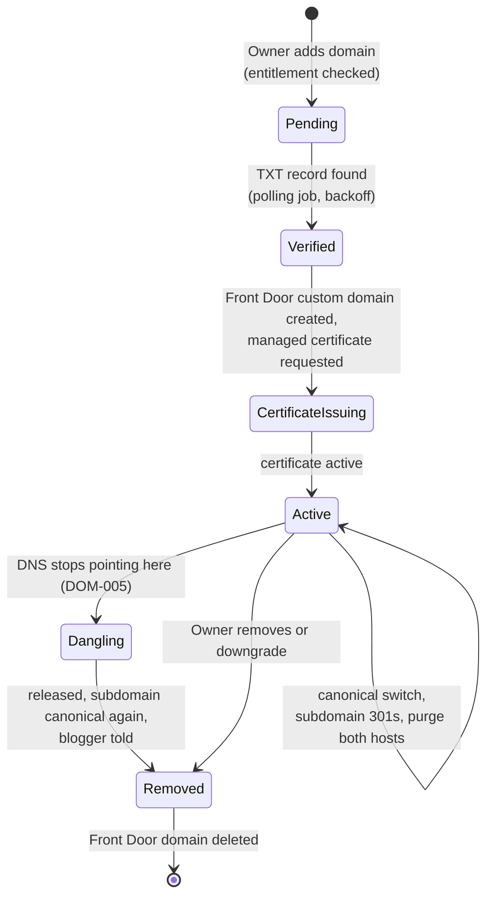

# PantryPress: Provisioning a Blogger's Site at Sign-Up

*Draft v0.1, 2026-10-24. For review by the owner. Pre-build for everything past PP1: the account, session and
outbox pieces exist; the Sites, Rendering, Billing and Domains modules do not yet.*

When a blogger signs up, PantryPress gives them a working blog at `{slug}.pantrypress.app` in under 60 seconds
(SITE-003), with no human in the loop. This document describes how. **The short answer is that sign-up
provisions data, not infrastructure.** Every Azure resource a blog needs already exists before the first
blogger arrives. "Their instance" is a set of rows keyed by `SiteId`, a theme snapshot, and a first build of
page data under the site's own blob prefix. The only cloud resource ever created for a single blogger is a
Front Door custom domain, and only if they opt into one on a paid plan.

Section 9 maps each piece to the prompt that builds it. Section 10 lists the gaps this design found in the
build plan.

---

## Contents

1. [Why not a deployment per blogger](#1-why-not-a-deployment-per-blogger)
2. [What exists before anyone signs up](#2-what-exists-before-anyone-signs-up)
3. [The journey from sign-up to live blog](#3-the-journey-from-sign-up-to-live-blog)
4. [Step 1: create the account](#4-step-1-create-the-account)
5. [Step 2: create the site](#5-step-2-create-the-site)
6. [Step 3: the provisioning job](#6-step-3-the-provisioning-job)
7. [Later, opt-in provisioning](#7-later-opt-in-provisioning)
8. [Lifecycle: trial end, non-payment, deletion](#8-lifecycle-trial-end-non-payment-deletion)
9. [Where each piece is built](#9-where-each-piece-is-built)
10. [Gaps and open decisions](#10-gaps-and-open-decisions)

---

## 1. Why not a deployment per blogger

The requirements settle this already (ADR 0003: the site is the tenant; ADR 0016: shared Azure, separate
data), but it is the first question anyone asks about "provisioning", so the reasoning is recorded here.

| Option                                                                  | Why it is not used                                                                                                                                                                                                                                |
| ----------------------------------------------------------------------- | ------------------------------------------------------------------------------------------------------------------------------------------------------------------------------------------------------------------------------------------------- |
| A database, storage account or container app per blogger                | First-year capacity is 2,000 sites (PNFR-004). A per-site database alone would cost more than a Starter subscription earns, and migrations would have to run 2,000 times per release.                                                             |
| A Front Door endpoint and DNS record per blogger                        | Standard allows 10 endpoints per profile. The wildcard `*.pantrypress.app` record and certificate already route every subdomain, so a new site needs no DNS change and no certificate issuance. That is what makes the 60-second target possible. |
| Infrastructure as code run at sign-up (Terraform or Bicep from the app) | Gives the application write access to the Azure control plane, takes minutes, and fails in ways a blogger cannot fix.                                                                                                                             |
| **Shared deployment, isolation in data (chosen)**                       | Sign-up is a database transaction plus one background job. Isolation is enforced by the `SiteId` query filter, stamping, `SiteId`-leading indexes and the two-site tests (`tenancy.md`).                                                          |

The consequence: **every guarantee a separate deployment would give, PantryPress has to give in code.** That is
why site isolation is the worst bug this product can have, and why every step below names its isolation rule.

---

## 2. What exists before anyone signs up

Deployed once per environment by Terraform in `docs/infrastructure/terraform/` (`platform` for the resources
shared with CreatorPantry, `pantrypress` for PantryPress's own). Nothing here changes when a blogger signs up.

| Resource                                                                            | What it gives every site                                               | Per-site partition                                               |
| ----------------------------------------------------------------------------------- | ---------------------------------------------------------------------- | ---------------------------------------------------------------- |
| Front Door Standard profile (shared), PantryPress endpoints and routes              | TLS, caching and WAF for `*.pantrypress.app` and `app.pantrypress.app` | Cache key includes the host; purge by host and path              |
| DNS zone `pantrypress.app` with a wildcard CNAME                                    | Every subdomain resolves to Front Door                                 | None needed                                                      |
| Wildcard certificate on Front Door                                                  | HTTPS on every subdomain from the first request                        | None needed                                                      |
| Container Apps: Gateway, ApiService, Site, SSR server, Worker, MigrationService job | All application code                                                   | `ISiteContext`, set per request or per job                       |
| Azure SQL (own server, one database)                                                | All transactional data                                                 | `SiteId` column, global query filter, `SiteId`-leading indexes   |
| Managed Redis                                                                       | Warm page data, the `SiteHost` map, rate-limit counters                | Site data under `SiteCacheKey`; host map and address limits under `PlatformCacheKey` |
| Storage account: `pagedata`, `media-originals`, `media-public`                      | Page data and media                                                    | Blob prefix `{siteId}/…`                                         |
| Key Vault, managed identities                                                       | Platform secrets                                                       | None: no per-site secret exists                                  |
| ACS Email and sending domain                                                        | Account and reader mail                                                | None: one sender for the platform                                |
| Stripe account and price catalogue                                                  | Plans and checkout                                                     | A Stripe customer per paying account, created lazily (section 7) |
| Platform reference data (reserved slugs, font registry, units, legal templates)     | Seeded by migrations                                                   | None: platform zone, no `SiteId` (ADR 0006)                      |

---

## 3. The journey from sign-up to live blog

Three steps run automatically. Each is a separate seam with its own transaction, so a failure in one never
leaves a half-made account or a half-made site.

Steps 4 to 6 below describe each part. "Launch my blog" (PP10.9) then walks the blogger through choosing a
preset, setting identity and writing a first post. Those steps call ordinary facades on an already-live site;
none of them is provisioning.

---

## 4. Step 1: create the account

**Seam:** `AccountRegistrationFacade` in `Modules/Accounts` (exists, PP1.2). **Route:** `/api/v1/account`,
account-scoped, never takes a site.

| Created                                                                                         | Zone                        | Notes                                                                                                    |
| ----------------------------------------------------------------------------------------------- | --------------------------- | -------------------------------------------------------------------------------------------------------- |
| Identity user (`ApplicationUser`)                                                               | Platform                    | Email unverified until the link is used (ACCT-001)                                                       |
| Verification email                                                                              | Outbox message `email.send` | Delivered by the Worker at least once; the message id names the email, so a redelivery sends nothing new |
| Trial subscription record (`AccountSubscription`, status `Trialing`, trial end = now + 14 days) | Platform, keyed by account  | PP14.7. Until PP14 exists, every account behaves as unlimited in local runs                              |

**Abuse controls run here, before anything is created** (ACCT-003, OPS-007): per-address rate limits on the
gateway and ApiService, the disposable-email list, the spam challenge, and, from PP19.9, new-site velocity
limits. Sign-up does not need a verified email; **publishing does** (ACCT-001), so an unverified account can
build a site but nothing becomes publicly readable beyond the "coming soon" page.

No Stripe call happens at sign-up. A trial needs no card and no Stripe customer (section 7).

---

## 5. Step 2: create the site

**Seam:** a `SitesFacade.CreateAsync` in `Modules/Sites` (PP2.10). **Route:** `POST /api/v1/sites` (account
level, because the site does not exist yet; every later admin route is `/api/v1/sites/{siteSlug}/…`).
**Idempotent:** yes, with `[Idempotent]`, so a double-clicked "Create" makes one site.

This step does everything that must be true the moment the request returns, in **one transaction**, and
nothing slow.

| Order | Action                                                                                                | Rule it enforces                                               |
| ----- | ----------------------------------------------------------------------------------------------------- | -------------------------------------------------------------- |
| 1     | Ask the entitlements facade: may this account create another site?                                    | ARCH-010; never a plan-name check                              |
| 2     | Validate the slug: 3 to 40 characters, ASCII, not reserved, not held by a rename (SITE-002, SITE-004) | Availability never reveals who holds a taken slug              |
| 3     | Insert `Site` with status `Provisioning`, name, time zone and locale from the sign-up form            | The tenant root has no `SiteId` of its own (PP2.2)             |
| 4     | Set `ISiteContext` to the new site id for the rest of the transaction                                 | Everything below is stamped by the interceptor, never by hand  |
| 5     | Insert `SiteMember` for the caller as `Owner`                                                         | Every site has at least one Owner (PP2.3)                      |
| 6     | Insert `SiteHost` `{slug}.pantrypress.app`, kind `Subdomain`, canonical                               | Unique host index; lower-case, no port or trailing dot (PP2.9) |
| 7     | Insert a default `SiteThemeSettings` (the Market preset, light mode) and default `SiteSettings`       | Typed settings only (PP-D17)                                   |
| 8     | Enqueue `sites.provision` with the site id                                                            | Outbox, same transaction (backend.md)                          |
| 9     | Audit `site.created`                                                                                  | Audit kernel                                                   |

The unique slug index is the race guard: two sign-ups taking the same slug at the same moment both pass
validation, one commits, the other gets 409 `slug-unavailable`.

At this point the public host already resolves, through `SiteHost`, to a site in `Provisioning`. The public
tier answers it with the neutral "coming soon" page and `503` plus a short `Retry-After`, never a 404, so a
search engine or an early visitor does not record the host as missing.

---

## 6. Step 3: the provisioning job

**Seam:** an `IOutboxHandler<ProvisionSite>` in the Worker (outbox from PP1.10), outbox type
`sites.provision`. **Target:** the site is `Live` within 60 seconds of step 2 at p95 (SITE-003).

The handler is a short list of steps. Delivery is at least once, so **each step checks whether its effect
already exists before acting**, and the handler can be re-run from the top after a crash at any line.

| Step                                      | Effect                                                                                                                                           | How it is safe to repeat                                                                      |
| ----------------------------------------- | ------------------------------------------------------------------------------------------------------------------------------------------------ | --------------------------------------------------------------------------------------------- |
| 1. Re-resolve the site                    | Load the site by the delivery's `SiteId`, set `ISiteContext`                                                                                     | If the site is gone or `Deleted`, finish quietly; if already `Live`, finish                   |
| 2. Seed starter content                   | Legal page drafts (Privacy, Disclosure, Accessibility, Terms) from PP8.5 templates; default navigation; default homepage section list (SITE-011) | Each seed has a fixed key per site (`legal:privacy`, …); insert only when missing             |
| 3. Apply the first theme snapshot         | Compile `SiteThemeSettings` into an immutable snapshot (tokens, `data-*`, fonts, contrast report)                                                | Snapshot keyed by `settingsHash`; an identical one is reused                                  |
| 4. Build first page data                  | Home, error pages, robots, an empty sitemap and feed, written to `pagedata/{siteId}/{version}/`                                                  | The version is derived from the snapshot and content hash, so a rebuild writes the same blobs |
| 5. Switch the live pointer and warm Redis | One atomic pointer switch (ARCH-006)                                                                                                             | Switching to the version already live is a no-op                                              |
| 6. Refresh the host map                   | Write the `SiteHost` entry into Redis and drop any negative-lookup entry for the host                                                            | Cache writes are overwrites                                                                   |
| 7. Purge the new host at the edge         | Front Door purge of `{slug}.pantrypress.app/*` through the purge gateway                                                                         | Purge is idempotent; batched with other purges (ARCH-012)                                     |
| 8. Mark the site `Live`                   | Status change with an optimistic concurrency check, audit `site.provisioned`                                                                     | Only `Provisioning` moves to `Live`; any other status is left alone                           |
| 9. Tell the blogger                       | "Your blog is ready" email when the admin app is not open (optional, see 10.3)                                                                   | Email message id derived from the site id                                                     |

**Steps 6 and 7 matter more than they look.** A slug is visible to the world as soon as it is typed. If anyone
requested `newblog.pantrypress.app` before the site existed, the Site API may hold a negative host lookup and
Front Door may hold a cached 404. Without this step the blogger's first view of their own blog could be "not
found" for as long as those TTLs last.

**Failure:** a step that throws is retried with backoff by the dispatcher. If attempts run out, the message is
poisoned and kept, the site stays `Provisioning`, the admin app keeps saying "We're still setting up your
blog", and an alert fires on build backlog age (OPS-004). The operator console (PP19.6) gets a "retry
provisioning" action that re-enqueues `sites.provision`; because every step is idempotent, that is always safe.
Nothing is rolled back: a partly provisioned site is invisible to readers and complete once the job succeeds.

**Isolation:** the handler takes `SiteId` only from the delivery, never the payload (tenancy.md rule 10), and
writes only under that site's blob prefix and cache keys. A two-site test provisions two sites with the same
starter content and proves neither one's pointer, cache entries, purge or snapshot touches the other.

---

## 7. Later, opt-in provisioning

These are created on demand, not at sign-up, because most bloggers never need them or need them only when
they pay.

| What                             | When                                         | Created by                                                                         | Per-site cloud resource?                                    |
| -------------------------------- | -------------------------------------------- | ---------------------------------------------------------------------------------- | ----------------------------------------------------------- |
| Stripe customer and subscription | First checkout (PP14.8)                      | Stripe gateway; the customer id lives on an integration record, never on `Account` | No (Stripe-side only)                                       |
| Entitlement changes              | Verified webhook through the outbox (PP14.6) | Billing facade                                                                     | No                                                          |
| Media                            | First upload                                 | Media facade; blobs under `{siteId}/`                                              | No                                                          |
| Publishing key                   | Owner creates one (PP18)                     | Publishing facade; shown once, stored salted and hashed                            | No                                                          |
| Member invitations               | Owner invites (PP2.11)                       | Sites facade                                                                       | No                                                          |
| **Custom domain**                | Owner adds one, paid plan only (DOM-001)     | Domains module, PP17                                                               | **Yes: a Front Door custom domain and managed certificate** |

### 7.1 Custom domains, the one piece of real infrastructure

This is the only flow where PantryPress creates an Azure resource for a single blogger, so it is the only one
where the Worker needs control-plane rights. Those rights are scoped to the Front Door profile's custom domains
and route associations, through the Worker's managed identity, and nothing else.

Each transition is an outbox message with an idempotent handler, as in section 6. Removal always restores the
subdomain as canonical before the Front Door domain is deleted, so the blog never goes dark (DOM-003).

---

## 8. Lifecycle: trial end, non-payment, deletion

Deprovisioning is the same idea in reverse: status changes, never infrastructure teardown, and content is
kept until a stated date (BILL-004, BILL-005).

| Event                                        | Site status                            | Public answer                          | Data                                                                                              |
| -------------------------------------------- | -------------------------------------- | -------------------------------------- | ------------------------------------------------------------------------------------------------- |
| Trial expires without payment (BILL-006)     | Unchanged, entitlements say "expired"  | "Coming soon" page                     | Kept                                                                                              |
| Payment fails                                | `ReadOnly` for 14 days, then `Offline` | Read-only: normal; Offline: 503 notice | Kept 90 days (DECIDE durations)                                                                   |
| Suspended by the operator (SITE-008)         | `Suspended`                            | Neutral notice                         | Kept; restore is immediate                                                                        |
| Owner deletes the site or account (ACCT-004) | `Deleted` after a grace period         | 410                                    | Erased by a `Modules/Platform/` job; page data and media prefixes removed; slug held from reissue |
| Custom domain removed                        | Unchanged                              | Subdomain canonical again              | Front Door domain deleted                                                                         |

Every status change purges the site's hosts at the edge through the outbox, the same way a theme change does.

---

## 9. Where each piece is built

| Piece                                               | Prompt                  | State                                           |
| --------------------------------------------------- | ----------------------- | ----------------------------------------------- |
| Account sign-up, verification email, abuse controls | PP1.2                   | Done                                            |
| Transactional outbox and Worker dispatcher          | PP1.10                  | In progress on `dev`                            |
| Audit log                                           | PP1.11                  | Not started                                     |
| `Site`, `SiteMember`, query filter, stamping        | PP2.2 to PP2.5          | Not started                                     |
| Reserved slugs and slug policy                      | PP2.8                   | Done                                            |
| `SiteHost` and canonical host                       | PP2.9                   | Not started                                     |
| Create-site endpoint                                | PP2.10                  | Not started                                     |
| Public host resolution and status answers           | PP2.12, PP2.13          | Not started                                     |
| Page-data build, pointer switch, warm-up            | PP7.11, PP7.12          | Not started                                     |
| Legal, About and Start here templates               | PP8.5, PP8.5a           | Not started                                     |
| Wildcard DNS, certificate and routes                | PP9.2                   | Not started (Terraform `platform` stack exists) |
| Cache purge gateway                                 | PP9.5                   | Not started                                     |
| "Launch my blog" flow                               | PP10.9                  | Not started                                     |
| Trial at sign-up, entitlements, site-count limit    | PP14.2, PP14.7, PP14.10 | Not started                                     |
| Custom domains                                      | PP17.1 to PP17.6        | Not started                                     |
| Operator retry, velocity limits                     | PP19.6, PP19.9          | Not started                                     |

---

## 10. Gaps and open decisions

### 10.1 Gaps in the build plan

| #    | Gap                                                                                                                                                                                                                                  | Suggested resolution                                                                                                                                                                                                                      |
| ---- | ------------------------------------------------------------------------------------------------------------------------------------------------------------------------------------------------------------------------------------ | ----------------------------------------------------------------------------------------------------------------------------------------------------------------------------------------------------------------------------------------- |
| G-01 | **No prompt owns the provisioning job.** PP2.10 creates the site rows; nothing moves a site from `Provisioning` to `Live`, seeds starter content, or builds its first page data. Those pieces arrive in PP7, PP8 and PP9, after PP2. | PP2.10 creates the site directly `Live` with no page data (the public tier answers "coming soon" when no pointer exists). Add a prompt after PP9.5 that introduces `sites.provision` (section 6) and switches creation to `Provisioning`. |
| G-02 | **Negative caching of a new host.** Neither PP2.12 nor PP9.4 says what happens to a cached "unknown host" answer when that host is later claimed.                                                                                    | Make step 6 and 7 of section 6 part of that prompt, and add a test: request the host, create the site, request again.                                                                                                                     |
| G-03 | **Front Door custom domain ceiling.** The `platform` Terraform notes 100 custom domains per Standard profile. DOM-001 allows Pro one custom domain per site, and the first-year target is 2,000 sites.                               | Record a trigger in the decisions register (alongside D-13): a second profile, or Premium, before custom domains pass about 80. PP17.1 checks a platform-wide count, not just the plan's allowance.                                       |
| G-04 | **IaC tool.** OPS-001 and architecture section 11 say `azd`-generated Bicep; the repo has Terraform under `docs/infrastructure/terraform/`.                                                                                          | Close D-16 and OPS-001 with Terraform, and move the folder to `infra/` when PP9.1 lands.                                                                                                                                                  |
| G-05 | **Worker control-plane rights.** PP17.4 needs the Worker to create Front Door custom domains; no rule says how narrow that grant is.                                                                                                 | A custom role on the profile limited to custom domains and route associations, assigned to the Worker's identity only. Add to `external.md`.                                                                                              |

### 10.2 Decisions recorded with a default

| Item                                  | Default assumed here                        | Closes at |
| ------------------------------------- | ------------------------------------------- | --------- |
| Public answer while `Provisioning`    | "Coming soon", `503` with `Retry-After: 30` | PP2.13    |
| Default preset for a new site         | Market, light mode                          | PP10.6    |
| Site created before email is verified | Allowed; publishing is not (ACCT-001)       | PP2.10    |
| D-10 trial or free Starter            | 14-day trial, no card (ADR 0010, Proposed)  | PP14      |

### 10.3 Open questions for the owner

1. Should the "your blog is ready" email go out at all, given that provisioning normally finishes while the
   blogger is still on the "Launch my blog" screen?
2. Should an account be allowed to create its site in the same step as sign-up (one form), or always after
   signing in? One form is quicker; two steps keep the account and site seams separate and let the spam
   challenge and velocity limits act before a slug is taken.
3. How long is a slug held after a site is deleted? SITE-004 says 12 months after a rename; deletion is not
   covered.
