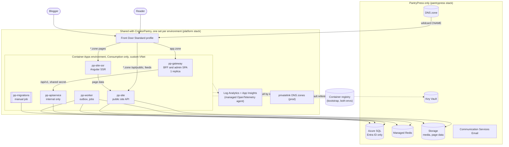

# Hosting plan: Azure Container Apps, dev and prod

- **Status:** Proposed. The Terraform is written and validated, but nothing has been applied yet.
- **Date:** 2026-10-24. Prices are Azure retail list prices for East US 2, taken from the Azure Retail Prices API on that date.
- **Scope:** where and how PantryPress runs in Azure, for a cloud `dev` environment and `prod`. Local development is
  unchanged: `aspire run` stays the inner loop.
- **Runbook:** [terraform/README.md](terraform/README.md) explains how to stand it up from a workstation. No pipeline
  is required.

**In one line:** dev costs about **$60 a month**, and prod at launch costs about **$250 a month**. In both, Front Door is
the largest fixed cost. Every app runs on a single Consumption-only Container Apps environment, which has no fixed fee.

---

## 1. Decisions this plan makes

Some of these choices change defaults recorded elsewhere. All of them were recorded in
[the decisions register](../architecture-decisions/pantrypress.md) on 2026-10-24, together with the requirements,
architecture, ADRs 0013 and 0016, and prompts they touch.

| Topic                  | This plan                                                                | What the docs said                                             | Status                                                                                                                                                                                                                                         |
| ---------------------- | ------------------------------------------------------------------------ | -------------------------------------------------------------- | ---------------------------------------------------------------------------------------------------------------------------------------------------------------------------------------------------------------------------------------------- |
| IaC tool               | **Terraform**, run by hand from a workstation (the owner asked for this) | OPS-001 DECIDE default: `azd`-generated Bicep from the AppHost | **OPS-001 closed.** The AppHost stays the source of truth for local runs, and the Terraform describes Azure. They are kept in step by hand: a `WithReference` added to `AppHost.cs` needs its environment variable in `pantrypress/locals.tf`. |
| Where shared IaC lives | `docs/infrastructure/terraform/platform`                                 | D-16 default: `infra/platform` in this repo                    | **D-16 closed.** Ownership is the same: this repo creates the shared resources, and CreatorPantry references them as existing. Only the path differs.                                                                                          |
| Environments           | `dev` and `prod` in Azure                                                | dev (local Aspire), staging, prod                              | The Azure `dev` environment does staging's job. PP9.10's "staging site live through Front Door" checkpoint runs there.                                                                                                                         |
| Front Door profiles    | One per environment, shared by both products                             | One profile shared with CreatorPantry                          | Sharing one profile across dev and prod would save $35 a month, but see section 8: the custom-domain cap makes that a bad trade.                                                                                                               |
| Region                 | East US 2                                                                | Not specified                                                  | It is among the cheapest US regions and offers every service used here. Change `location` before the first apply.                                                                                                                              |

## 2. Topology

Three Terraform stacks, applied in order:

| Stack         | Scope                                                    | What it creates                                                                                                                                                                                     |
| ------------- | -------------------------------------------------------- | --------------------------------------------------------------------------------------------------------------------------------------------------------------------------------------------------- |
| `bootstrap`   | Once per subscription, local state                       | The Terraform state account (Entra ID only, versioned) and the container registry that both environments pull from. One registry means prod runs the exact image dev tested.                        |
| `platform`    | Once per environment, shared with CreatorPantry (PP-D16) | Log Analytics, App Insights, the VNet and Container Apps subnet, the Container Apps environment with the managed OpenTelemetry agent, the Front Door profile, and the privatelink DNS zones (prod). |
| `pantrypress` | Once per environment, PantryPress only                   | Identities, Key Vault, storage, SQL, Redis, email, the DNS zone, Front Door endpoints, domains, routes, and WAF, the five apps and the migration job, private endpoints (prod), and the budget.     |

The `pantrypress` stack finds the shared resources by name, the way CreatorPantry's IaC will. It never manages them. The
only things it adds to them are its own subnet, its own Front Door endpoints, and its own WAF policies.

## 3. Choices made for cost

| Component         | Choice                                                                                     | Why this is the cheapest option that works                                                                                                                                                                                          | Rejected                                                                                                                                                            |
| ----------------- | ------------------------------------------------------------------------------------------ | ----------------------------------------------------------------------------------------------------------------------------------------------------------------------------------------------------------------------------------- | ------------------------------------------------------------------------------------------------------------------------------------------------------------------- |
| Compute           | One Container Apps environment with workload profiles and the **Consumption profile only** | No fixed fee. The $0.10/hour environment management fee applies only to Dedicated profiles, an environment private endpoint, or planned maintenance, and none of those is used. Apps pay per second, and in dev they scale to zero. | Dedicated D4: about $73/month in management fees before any compute. Consumption-only legacy environment: needs a /23 subnet and lacks UDR support, with no saving. |
| Network           | A custom VNet in both environments                                                         | Free. It gives the trusted-proxy setting a known address range, and in prod it gives the private endpoints a home.                                                                                                                  | The managed VNet: free as well, but the proxy's address range is unknown, so `Edge:TrustedProxies` could not be set safely.                                         |
| Edge              | Front Door **Standard**, one profile per environment                                       | $35/month base. Wildcard managed certificates (generally available since June 2025) mean no certificate to buy.                                                                                                                     | Premium: managed rule sets and Private Link, for a much higher base fee (D-13 already rejects it for launch).                                                       |
| Database          | **DTU tiers:** Basic in dev (~$4.90), S1 in prod (~$29.43)                                 | The Worker's outbox dispatcher (PP1.10) touches SQL all day, so a database that could pause never would.                                                                                                                            | Serverless GP at $0.52/vCore-hour costs **~$190/month** at its 0.5 vCore minimum. The free SQL offer's 100,000 vCore-seconds run out in about two days of polling.  |
| Cache             | Azure Managed Redis **Balanced B0**: one node in dev (~$11.68), HA in prod (~$23.36)       | The smallest managed size. Redis is never the source of truth: page data falls back to blob storage.                                                                                                                                | Azure Cache for Redis: no new instances. Redis in a container: about $6 cheaper, but no SLA and a different connection setup from prod.                             |
| Storage           | One account, LRS in dev and ZRS in prod, old blob versions expire after 7 or 30 days       | Pennies per GB. Versioning satisfies OPS-008, and the expiry rule keeps page-data rebuilds from doubling the bill.                                                                                                                  | GRS: about 60% more per GB, and the media originals already survive a zone outage with ZRS.                                                                         |
| Private endpoints | **Prod only** (4 × ~$7.30)                                                                 | The requirement says "where the environment supports them". Dev holds no reader data.                                                                                                                                               | Private endpoints in dev: +$29/month for test data.                                                                                                                 |
| WAF               | Prod only: two policies at $5 plus $1 per custom rule                                      | Separate policies for readers and sign-in (ADR 0013).                                                                                                                                                                               | Dev WAF: +$14/month. Turn it on to rehearse PP9.8's rules.                                                                                                          |
| Registry          | One ACR Basic (~$5) for both environments                                                  | Promotes the same image from dev to prod.                                                                                                                                                                                           | One registry per environment: twice the fee and two copies of each image.                                                                                           |
| Telemetry         | The managed OpenTelemetry agent sends to the shared App Insights                           | No code change: ServiceDefaults already exports OTLP when the agent sets its endpoint.                                                                                                                                              | The Azure Monitor exporter in code.                                                                                                                                 |
| Health probes     | No Front Door probes (one origin per group)                                                | A probe only chooses between origins, and with one origin it is just billed requests.                                                                                                                                               |                                                                                                                                                                     |
| Edge caching      | **Off** until PP9.4                                                                        | Without Cache-Control headers, Front Door caches for one to three days on its own, which would hide every publish. Turning it on is PP9.4's job.                                                                                    |                                                                                                                                                                     |

## 4. Dev and prod side by side

|                     | dev                                                     | prod                                              |
| ------------------- | ------------------------------------------------------- | ------------------------------------------------- |
| Hosts               | `{slug}.dev.pantrypress.app`, `app.dev.pantrypress.app` | `{slug}.pantrypress.app`, `app.pantrypress.app`   |
| ASP.NET environment | `Staging` (Production behavior, a different name)       | `Production`                                      |
| Gateway             | 0.25 vCPU, 0–1 replica                                  | 0.5 vCPU, exactly 1 replica                       |
| ApiService          | 0.25 vCPU, 0–1, internal ingress                        | 0.5 vCPU, 1–3, internal ingress                   |
| Site API            | 0.25 vCPU, 0–1                                          | 0.5 vCPU, 1–5                                     |
| SSR                 | 0.5 vCPU, 0–1                                           | 0.5 vCPU, 1–10                                    |
| Worker              | 0.25 vCPU, exactly 1                                    | 0.5 vCPU, exactly 1                               |
| SQL                 | Basic, 2 GB, 7-day restore, local backups               | S1, 250 GB, 35-day restore (OPS-008), geo backups |
| Redis               | B0, no HA, public with key and TLS                      | B0 HA, private endpoint only                      |
| Storage             | LRS, public with Entra ID only                          | ZRS, firewall with a private endpoint             |
| Key Vault           | Public, RBAC                                            | Firewall plus private endpoint, purge protection  |
| WAF                 | Off                                                     | Prevention, rate limit plus scanner-path block    |
| Delete locks        | None (dev can be torn down)                             | SQL server and storage account                    |
| Logs                | 0.5 GB/day cap                                          | No cap                                            |

Prod keeps one replica of each public-tier app running at all times, so a cache miss never waits for a cold start.
Dev accepts a few seconds of cold start after an idle spell.

## 5. Monthly cost estimate

Rates (East US 2 retail, 2026-10-24): Front Door Standard $35 base, $0.009 per 10k requests, $0.083/GB to clients
(first 10 TB); WAF $5 per policy and $1 per rule. Container Apps $0.000024 per vCPU-second active, $0.000003 idle,
$0.000003 per GiB-second, with 180,000 vCPU-seconds and 360,000 GiB-seconds free per subscription per month. SQL
Basic $0.161/day, S1 $0.9677/day. Managed Redis B0 $0.016/hour per node. ACR Basic $0.1666/day. Log Analytics
$2.76/GB after the free 5 GB. A private endpoint lists at about $0.01/hour, which the calculator should confirm.

| Line                                                             | dev         | prod at launch (~100k page views/month) |
| ---------------------------------------------------------------- | -----------:| ---------------------------------------:|
| Front Door base                                                  | 35          | 35                                      |
| Front Door requests and egress (25 requests, 2 MB per page view) | ~1          | ~19                                     |
| WAF (2 policies, 4 rules)                                        | 0           | 14                                      |
| Container Apps                                                   | 3–10        | 60–100                                  |
| SQL                                                              | 4.90        | 29.43                                   |
| Managed Redis                                                    | 11.68       | 23.36                                   |
| Private endpoints and their DNS zones                            | 0           | ~31                                     |
| Storage, Key Vault, DNS, email                                   | ~2          | ~5                                      |
| Log Analytics and App Insights                                   | 0–5         | 5–20                                    |
| **Total**                                                        | **~$58–70** | **~$220–280**                           |
| Container registry (shared by both)                              | 5.07        |                                         |

**At the first-year target** (5 million page views a month, 2,000 sites): traffic dominates. Front Door egress comes to about
10 TB, roughly $830, plus ~$110 in requests. SQL probably steps up to S2 ($73.60), and the public tier scales out. The
total is on the order of **$1,300–1,500 a month, about $0.70 per site** (KPI-006). Image weight is the biggest lever on
that bill, through MED-002's AVIF/WebP derivatives and responsive `srcset`.

**Ways to spend less, and what each costs you:**

- Destroy dev when it is idle: `./run.ps1 pantrypress dev destroy`, then the same for `platform`. Cost drops to about $0;
  the trade is about 20 minutes and a certificate revalidation to bring it back.
- Prod without private endpoints: −$31. Every store keeps a public endpoint behind its firewall and Entra ID auth.
- Prod Redis without HA: −$11.68. There is no SLA, and the fallback is blob storage.
- Prod SQL at S0 for launch: −$14.71. It has half of S1's throughput.

## 6. What the infrastructure enforces

- **Only Front Door reaches the apps.** Every app with external ingress accepts only the `AzureFrontDoor.Backend` IPv4
  ranges, read from the service tag at plan time; the Site API also accepts the environment's own subnet. An NSG cannot
  do this job, because on an external workload-profile environment inbound traffic arrives on a public IP the NSG never
  sees. `X-Azure-FDID` (output `front_door_id`) is PP9.3's check on top of the address list.
- **ApiService has no public address.** It is internal ingress only, until the publishing API (O-01) and the Stripe
  webhook (O-02) get their Front Door route.
- **No passwords exist for data.** SQL is Entra ID only, with each app connecting as its own managed identity. Storage
  has account keys disabled. Apps pull images by identity. Key Vault is RBAC only, and each app can read only its own
  secrets.
- **Secrets never touch Terraform state.** The gateway's shared secret is generated during apply and written to Key
  Vault as a write-only value. The platform admin list is passed in at apply time and written the same way. Only the
  Redis access key is in state, because the provider reads it back; keep the state account locked down.
- **Trusted proxies are explicit.** `Edge__TrustedProxies` names the Container Apps subnet plus the Front Door
  ranges, with `ForwardLimit` 2: Front Door's hop and the environment proxy's. The gateway gets `HTTPS_PORT=443` beside
  it, as PP1.8 asked.
- **Prod data cannot be deleted by accident.** The SQL server and the storage account have `CanNotDelete` locks.
  `run.ps1` refuses to destroy prod.
- **Spend alerts.** OPS-009 budgets fire at 50%, 80%, and 100%, plus a forecast warning. They cover the environment's
  PantryPress and platform resource groups.

## 7. What the app still has to do before this serves real traffic

None of these stops the Terraform from applying. Until a placeholder image is replaced, every app comes up running a
Microsoft sample image on port 8080.

| Gap                                                                                                                                                        | Effect until closed                                                                                                                     | Where                               |
| ---------------------------------------------------------------------------------------------------------------------------------------------------------- | --------------------------------------------------------------------------------------------------------------------------------------- | ----------------------------------- |
| No container images yet. The .NET apps can use `dotnet publish -t:PublishContainer`; the SSR server needs a Node Dockerfile.                               | Sample images run.                                                                                                                      | PP19.2                              |
| `/health` and `/alive` are mapped only in Development.                                                                                                     | Probes are TCP, not HTTP.                                                                                                               | PP19.2                              |
| The gateway's data-protection key ring is not persisted (PP1.6, PP1.7).                                                                                    | The gateway is pinned to one replica, and a restart signs everyone out. The Key Vault key and blob container for the fix already exist. | PP19                                |
| ApiService's data-protection key ring is not persisted either, and since PP1.10b the Worker makes the links in account email that ApiService checks (PP1.12). | Deployed, the Worker sends no account email: it has no provider before PP13.1, and it refuses to send without the shared ring, so PP19's persisted ring must come first. Its container (`data-protection`) and key exist, apart from the gateway's (`data-protection-gateway`). | PP19, before PP13.1 |
| The production gateway image must contain the built admin SPA.                                                                                             | `app.` serves only the API.                                                                                                             | PP19                                |
| Front Door forwards the blog's host in `X-Forwarded-Host`. The public tier does not trust it yet, and Angular SSR's `allowedHosts` is empty in production. | Blog hosts answer the neutral 404 or 400.                                                                                               | PP9.3                               |
| No Cache-Control per response yet.                                                                                                                         | Edge caching stays off, and every request reaches an origin.                                                                            | PP9.4                               |
| Public media has no Front Door route, and Front Door Standard cannot use Private Link.                                                                     | `media-public` stays private.                                                                                                           | O-04                                |
| The publishing API and Stripe webhook have no edge host.                                                                                                   | ApiService stays internal.                                                                                                              | O-01, O-02                          |
| ACS is provisioned, but nothing sends through it.                                                                                                          | Account email in Azure goes nowhere.                                                                                                    | PP13.1                              |
| Redis has no consumer, and its auth is by access key.                                                                                                      | Unused. Switch to Entra ID when Redis gets its first consumer.                                                                          | First Redis prompt                  |
| `dev` and `app` must be reserved slugs.                                                                                                                    | A prod blog called `dev` would collide with the dev zone.                                                                               | The reserved slug list (`sites.md`) |

## 8. Risks and limits

| Risk                                                                                                                                                  | Why it matters                                                                                                                                                          | Mitigation                                                                                                                                                                                       |
| ----------------------------------------------------------------------------------------------------------------------------------------------------- | ----------------------------------------------------------------------------------------------------------------------------------------------------------------------- | ------------------------------------------------------------------------------------------------------------------------------------------------------------------------------------------------ |
| **Front Door Standard allows 100 custom domains and 10 endpoints per profile.**                                                                       | DOM-001's opt-in custom domains, plus the wildcard, plus `app.`, plus CreatorPantry's share, all count. Somewhere under 100 paying custom domains, the profile is full. | **D-13b** (opened 2026-10-24, closes at PP17.1): add a second profile ($35) or move to Premium (500) before PantryPress's custom domains on a profile pass 80. PP17.1 counts them platform-wide. |
| Managed wildcard certificates do not rotate by themselves.                                                                                            | When the wildcard certificate lapses, every blog goes down at once.                                                                                                     | The `certificate_expiry` output shows the date. Ahead of it, re-apply the PantryPress stack, which refreshes the `_dnsauth` token. Alert on certificate expiry (OPS-004).                        |
| The trusted-proxy assumptions are unproven: that the environment's proxy connects from the subnet and appends to `X-Forwarded-For` the way described. | A wrong guess makes every client look like Front Door. That breaks per-address limits and HSTS, and admin writes are refused.                                           | Verify on the first dev apply: sign in, then check `RemoteIpAddress` in the logs. PP9.3 owns the spoofing tests.                                                                                 |
| The managed OpenTelemetry agent patch uses API `2026-07-01`, which azapi 2.13 cannot check locally.                                                   | A mistake surfaces only at apply.                                                                                                                                       | It is one resource on the platform stack. If Azure rejects it, the fix is the API version or body.                                                                                               |
| Azure Communication Services record names are normalized by a guess.                                                                                  | Email verification fails.                                                                                                                                               | Compare `terraform output email_verification_records` with the portal. Nothing else depends on it.                                                                                               |
| `Allow Azure services` on dev SQL lets any Azure tenant reach the endpoint.                                                                           | Only an Entra identity that SQL knows can sign in, so the exposure is limited to the network path.                                                                      | Accepted for dev. Prod has no such rule.                                                                                                                                                         |
| The AppHost and the Terraform can drift apart.                                                                                                        | A new reference works locally and fails in Azure.                                                                                                                       | Review `pantrypress/locals.tf` with every `AppHost.cs` change. Moving to `aspire publish` output later would remove this risk.                                                                   |

## 9. How this was checked

- `terraform validate` and `terraform fmt -check` pass on all three stacks (Terraform 1.17.0, azurerm 5.11.0, azapi
  2.13.0, random 3.9.1, time 0.14.2). Provider lock files cover Windows, Linux, and macOS.
- Each stack ran end to end under `terraform test` with mocked providers, once with `env/dev.tfvars` and once with
  `env/prod.tfvars`. The provider's own value checks still run under mocks (every SKU, tier, and mode was checked),
  and the tests asserted the shape of each environment: app count, private endpoints, WAF policies, locks, ingress
  allow-lists, trusted-proxy entries, and the rendered SQL grant script.
- **Not yet done:** a `plan` or `apply` against Azure. The first real run is
  [the runbook's](terraform/README.md) dev walk-through.
